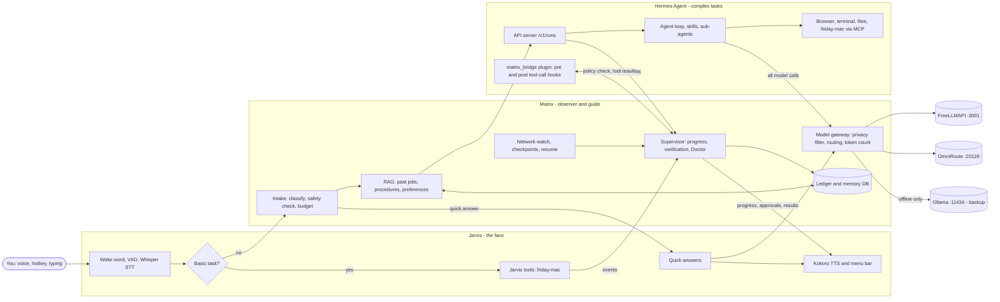
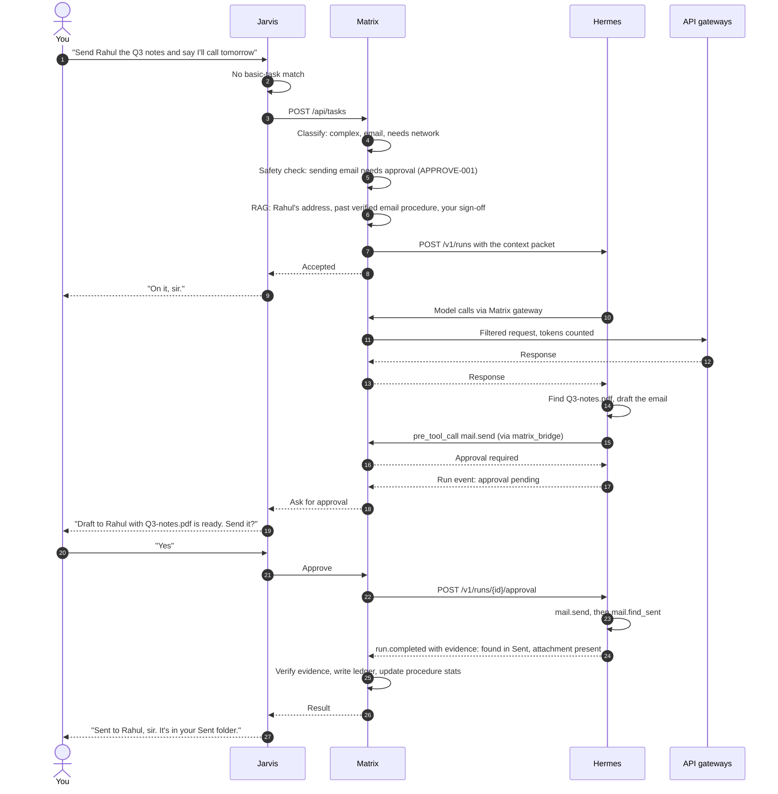
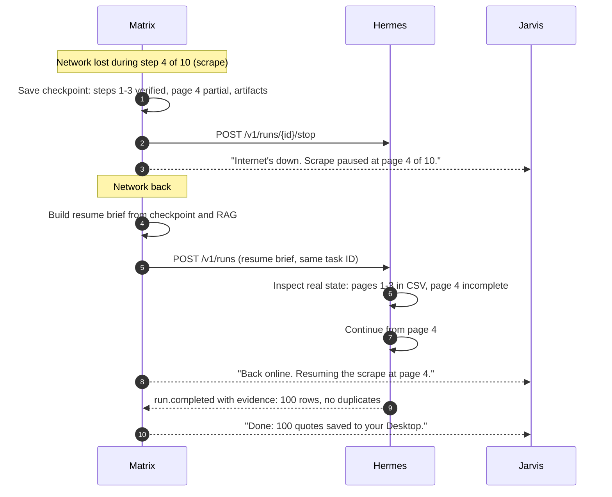

# Alex — Trinity Architecture Plan v3

## Jarvis (the face, basic tasks) × Matrix (observer and guide) × Hermes Agent (complex tasks)

> **Project:** Friday (Azarath v3)
> **Location:** `/Users/mdshabazkhan/Documents/Work/AI Project - Azarath/Friday`
> **Author:** Mohammed Shabaz Khan
> **Date:** 2026-11-14 (v3 supersedes the v2 content previously in this file)
> **Target machine:** a 16 GB Apple Silicon Mac
> **Objective:** A JARVIS for macOS that gets the job done fast, efficiently, correctly and cheaply. Jarvis handles basic tasks, Hermes handles complex ones, and Matrix sits between them: it checks safety, remembers what worked before, keeps token use low, reports progress, records every job, and recovers work when the internet drops. Thinking runs on API models through FreeLLMAPI and OmniRoute; small local Ollama models are the backup.

**Safety rules live in a separate file you can edit:** [Friday_Safety_Guardrails.md](Friday_Safety_Guardrails.md).

---

## 0. The plan on one screen

### The three roles

| Part | Role | Does it execute actions? |
|---|---|---|
| **Jarvis** | The face and the quick hands. Wake word, voice, hotkey, menu bar. Runs basic Mac actions directly (Wi-Fi, volume, apps, media, simple file actions) and answers quick questions. Speaks progress and results. | Yes, basic tasks only |
| **Hermes Agent** | The worker for complex tasks: email, browser, research, scraping, coding, multi-step jobs, sub-agents. | Yes, complex tasks only |
| **Matrix** | The connector between Jarvis and Hermes. Supervisor, doctor, record-keeper and guide. Checks safety, retrieves past experience (RAG), builds a compact brief for Hermes, filters what is sent to API models, counts tokens and cost, relays progress, verifies results, logs bugs, checkpoints and resumes interrupted work, produces the Excel report. | **No.** It never clicks, sends, moves or browses. It advises, approves or blocks, records, and asks Jarvis or Hermes to act |

Matrix is an observer and guide, not a second agent brain. It can say "no" in exactly four places: the safety check before a task starts, the tool-call check before Hermes performs an action, the same check before a Jarvis action, and the model gateway that decides what text leaves your Mac. Everything else it does is watching, remembering, advising and reporting.

### What changed from v2

| v2 | v3 | Why |
|---|---|---|
| One local brain (Qwen 35B-A3B class) on a 48 GB Mac | **API-first** through FreeLLMAPI → OmniRoute, with optional direct API keys | A 16 GB Mac can't hold a large local model alongside macOS, Chrome and Hermes. You already run both gateways |
| No small models | **Small Ollama models as backup**: `qwen3:4b-instruct` (offline Hermes fallback), `qwen2.5-coder:7b` (offline coding help), `bge-m3` (RAG embeddings) | Offline work still needs a model; one small model at a time fits in 16 GB |
| `friday-actions` router, Doctor, `friday-memory` plugin as separate pieces | **Matrix** owns policy, RAG, progress, verification, records, recovery and diagnosis in one service | One connector with one ledger, instead of several half-connected parts |
| Guardrails as a section of the plan | **A separate, editable file** with stable rule IDs, mirrored into `config/guardrails.yaml` | You can add or delete rules without touching the architecture |
| Hermes talks to the model server directly | **Hermes talks to Matrix's model gateway**, which forwards to the API gateways or Ollama | One place to filter outbound data, count tokens, enforce budgets and switch to local models when offline |
| No reporting | **Task ledger + Excel report** (Jobs, Steps, Costs, Bugs, Providers, Summary) | Track jobs, token spend, time and bugs so you can fix things later |
| "Reflex lane" vs "Hermes lane" (and v1's Big-O tiers) | **Basic task → Jarvis, complex task → Hermes** | Simpler language, same idea |

### Matrix's four goals for every job

1. **Fast:** basic tasks never touch a model; complex tasks start with a brief that already contains what worked last time.
2. **Efficient:** short context packets, trimmed tool lists, no repeated exploration of things Friday already knows.
3. **Correct:** nothing counts as done without evidence from the executor; actions are never repeated by accident.
4. **Cheap:** free gateways first, token budgets per task, and every token recorded so waste shows up in the report.

---

## 1. Who does what

| You ask for | Executor | What Matrix adds |
|---|---|---|
| Toggle Wi-Fi, Bluetooth, volume, dark mode | Jarvis | Records the action and its verification |
| Open or close apps and files, play a song on YouTube | Jarvis | Records; if Jarvis can't resolve it ("open the pod bay doors"), Matrix hands it to Hermes |
| A quick question ("how far is the moon?") | Jarvis, using the `fast` API profile | Routes the model call, counts tokens, caches nothing personal |
| Send an email to a colleague | Hermes | Safety check, contact and past-procedure lookup, approval before sending, verification in Sent |
| Move or organise files and folders | Jarvis for a single clear move; Hermes for multi-step organising | Undo record, checksum verification, offline takeover |
| Surf the web, scrape a site, research | Hermes | Prior-job reuse, progress updates, checkpoint if the internet drops |
| Write code, build an app | Hermes (`coding` profile) | Budget, checkpoints, records of bugs found |
| Book a meeting (Outlook, fall back to Zoom) | Hermes | Doctor diagnoses the failure and advises the known alternative route |
| Remember what you like | — | Matrix stores preferences and adds them to the brief when relevant |
| Tell you what's happening | Jarvis speaks | Matrix turns Hermes events into short progress updates |
| A report of everything | — | Matrix exports the Excel workbook |

---

## 2. Design rules

1. **Two executors, one connector.** Jarvis does basic tasks, Hermes does complex tasks, Matrix connects and records. Matrix never executes.
2. **Cheapest correct path:** deterministic code → CLI or API → model reasoning → screen automation as the last rung. Never use a model for what a pattern match can do.
3. **Nothing is done until verified.** Every action returns evidence. Friday says "done" only when the evidence confirms it.
4. **API first, local as backup.** Cloud models do the thinking; local models take over only when the network is gone and the task can safely run offline.
5. **Every outbound model request passes through Matrix.** No component calls a gateway directly.
6. **Safety rules are data, not code.** They live in the guardrails file and its YAML mirror, so you change them without changing Friday.
7. **Learn from outcomes, never from experiments.** Matrix learns from real results and read-only checks; it never tries a real send or booking "to see".
8. **Every phase ships a working Friday; every upgrade passes the eval suite.**

---

## 3. Architecture



### Processes and ports (all bound to `127.0.0.1`, each with its own key)

| Process | Port | Notes |
|---|---|---|
| Jarvis | — | Its own Python venv; menu-bar app |
| Matrix | `8700` | `/v1/*` = OpenAI-compatible model gateway (for Hermes and Jarvis); `/api/*` = task API for Jarvis (tasks, status, approvals, progress stream) |
| Hermes Agent | `8642` | `hermes gateway` with the API server enabled |
| FreeLLMAPI | `3001` | Your existing install (adjust if yours differs) |
| OmniRoute | `20128` | Your existing install |
| Ollama | `11434` | Loads models only on demand |

---

## 4. One request, end to end: "Send Rahul the Q3 notes"



What Hermes receives from Matrix (the context packet, roughly 300 tokens instead of a long history):

```text
[Matrix brief · task T-20261114-0042 · budget 60K tokens · policy v7]
Goal: Send Rahul the Q3 notes; mention a call tomorrow.
Known: Rahul = Rahul Mehta <rahul.mehta@example.com> (contacts, confirmed 3 Nov).
Done before (verified 2x, avg 41 s, 18K tokens): mail.compose(to, subject, body, attach)
  -> approval -> mail.send -> mail.find_sent.
Pitfall: two files match "Q3 notes"; last time you chose Q3-notes.pdf, not the .docx draft.
Preferences: short emails; sign off "Regards, Shabaz".
Rules: sending needs approval. Don't repeat verified steps. Start with a numbered plan,
  one line per step; report milestones as "STEP n/N: ...".
Done when: the message is in Sent with the attachment.
```

---

## 5. Components

### 5.1 Jarvis: the face and quick hands

| Piece | Choice | Why |
|---|---|---|
| Wake | openWakeWord ("hey jarvis" now, train "hey friday" later) + push-to-talk hotkey | Free, local, tiny |
| End of speech | Silero VAD, ~0.7 s trailing silence, 30 s cap | Replaces the fixed 10 s recording |
| Speech-to-text | whisper.cpp (Metal) with `large-v3-turbo` quantized (q5_0) or `small.en` if memory is tight | Runs on the GPU; faster-whisper is CPU-only on Macs |
| Basic tasks | `config/reflexes.yaml` → matcher → `friday-mac` functions (§7) | No model, under 1 s |
| Quick answers | One call to Matrix's gateway with the `fast` profile, no tools | Cheap; offline it uses the local backup model |
| Matrix client | `POST /api/tasks`, subscribe to `/api/tasks/{id}/events`, send approvals and "stop" | Jarvis never talks to Hermes directly |
| Text-to-speech | Kokoro | Local; already in Azarath |
| Presence | Menu-bar icon (rumps): idle · listening · thinking · N tasks running, with step n/N per task | Replaces Tauri |
| Filler | Only if no first word arrives within ~800 ms; never for basic tasks | Replaces fillers that fire before instant replies |

Jarvis reports every basic action (what, when, verified or not, how long) to Matrix so the ledger covers both executors. If Matrix is down, Jarvis still performs basic tasks and queues the records locally.

### 5.2 Matrix: observer and guide

| Module | Job |
|---|---|
| `intake` | Classify basic vs complex vs quick answer, detect `needs_network` / `offline_capable`, assign task ID, run the safety check, set a token budget |
| `policy` | Load and validate `config/guardrails.yaml`; answer allow / notify / approve / deny for tasks, tool calls and outbound data |
| `context` | RAG over past jobs, procedures, pitfalls, facts and preferences; build the context packet within a token ceiling (§10) |
| `gateway` | OpenAI-compatible endpoint for Hermes and Jarvis: privacy filter, profile routing, budgets, token and cost accounting, offline switch to Ollama (§6, §8) |
| `supervisor` | Start Hermes runs, consume run events and `matrix_bridge` hook calls, relay approvals, turn events into progress (§11), verify completion evidence (§12) |
| `doctor` | Classify failures, read-only diagnosis, advise Hermes via `/steer`, open or update bug records (§12) |
| `recovery` | Watch the network, checkpoint tasks, request local takeover or resume (§13) |
| `reports` | Export the Excel workbook (CSV fallback) (§14) |
| `store` | `ledger.db` (what happened) and `memory.db` (what Friday knows), both SQLite, Matrix is the only writer |

### 5.3 Hermes Agent: complex tasks

- **Install natively**, terminal backend `local`. Run `hermes gateway` with the API server enabled on `127.0.0.1:8642` with a key. Pin a stable release; upgrade only through the eval gate (§17).
- **Model provider = Matrix's gateway**, never a gateway or API directly. Leave Hermes's `fallback_providers` empty: a direct fallback would bypass the privacy filter and the token accounting. Matrix handles fallback.
- **Toolsets on:** terminal, files, browser (a dedicated "Friday" Chrome profile), web search, `computer_use` (last rung), delegation, skills, MCP (`friday-mac`). **Off:** image generation, messaging platforms (until Phase 6), Hermes voice/TTS (Jarvis speaks). Every tool schema removed saves tokens on every call; check with `hermes prompt-size`.
- **Two small Friday plugins:**
  - `matrix_bridge` registers `pre_tool_call` (Matrix returns allow, `approve` or `block`; Hermes fails closed if Matrix doesn't answer in time) and `post_tool_call` (tool name, duration, status, error, evidence go to the ledger).
  - `matrix_memory` is a Hermes memory provider whose `prefetch()` asks Matrix for relevant memory mid-run, so Friday keeps one memory store.
- **Safety:** Hermes's own approvals stay on (never yolo); checkpoints and rollback on for file work.
- **Persona** in `hermes/SOUL.md`: address you as "sir", calm and brief, report outcomes rather than intentions, follow the `STEP n/N` milestone format.

```yaml
# ~/.hermes/config.yaml (excerpt; confirm key names with `hermes model` for your pinned release)
model:
  provider: custom:matrix
  default: friday-agent
providers:
  matrix:
    api: http://127.0.0.1:8700/v1
    key_env: MATRIX_GATEWAY_KEY
    transport: chat_completions
    session_affinity_header: X-Friday-Session   # lets Matrix attribute every call to a task
    models:
      friday-agent:  {context_length: 131072}   # set to the smallest window in the agent profile's chain
      friday-coding: {context_length: 131072}
      friday-local:  {context_length: 65536}    # Hermes's documented minimum for tool use
# fallback_providers: intentionally not set
```

### 5.4 `friday-mac`: self-verifying Mac tools

One Python package and one stdio MCP server: Jarvis imports it, Hermes calls it over MCP. Merge Matrix's 78 and Azarath's 68 tools into about 11 grouped tools (a model picks the right tool more reliably from ~11 schemas than from ~150, and it costs fewer tokens).

| Tool | Actions |
|---|---|
| `system` | wifi, bluetooth, volume, brightness, dark_mode, do_not_disturb |
| `apps` | open, quit, focus, list_running, resolve_name |
| `files` | copy, move, trash, find, reveal (copy → checksum → original to Trash; undo kept) |
| `media` | play_youtube, play_local, pause, next |
| `mail` | compose, send, find_sent (Mail.app or Outlook app; Outlook web via Hermes browser as an alternative route) |
| `windows` | arrange, minimize, list |
| `clipboard`, `notify`, `network`, `screen`, `shortcuts` | read/write; notification; status; frontmost app and screenshot path; run a macOS Shortcut |

Every call returns `{ok, verified, evidence, undo}`.

---

## 6. Models: API first, local as backup, sized for 16 GB

### 6.1 Gateways and profiles

Matrix's gateway exposes a handful of model names (`friday-fast`, `friday-agent`, `friday-coding`, `friday-reasoning`, `friday-vision`, `friday-local`, `friday-local-coder`). Each maps to a profile: an ordered chain of gateway routes. FreeLLMAPI and OmniRoute already rotate keys, track rate limits and fail over between their own providers, so Matrix doesn't repeat that work. It only moves to the next gateway when one is down or out of quota, and it records which provider and model actually answered.

```yaml
# config/profiles.yaml (no keys here: keys come from environment variables or Keychain)
gateways:
  freellmapi: {base_url: "http://127.0.0.1:3001/v1",  key_env: FREELLMAPI_KEY}
  omniroute:  {base_url: "http://127.0.0.1:20128/v1", key_env: OMNIROUTE_KEY}
  ollama:     {base_url: "http://127.0.0.1:11434/v1"}
  # direct API-key providers are added here later as extra gateways, e.g.:
  # paid_api: {base_url: "...", key_env: PAID_API_KEY, monthly_usd_cap: 10}

profiles:
  fast:      {chain: ["freellmapi:auto", "omniroute:auto"], max_output_tokens: 400, tools: false}
  agent:     {chain: ["freellmapi:<tool-capable chain>", "omniroute:<tool-capable combo>"], require_tools: true}
  coding:    {chain: ["freellmapi:<coding chain>", "omniroute:<coding combo>"], require_tools: true}
  reasoning: {chain: ["omniroute:<reasoning combo>", "freellmapi:auto"]}
  vision:    {chain: ["omniroute:<vision combo>"]}
  local:       {chain: ["ollama:qwen3-4b-64k"], offline_only: true}
  local_coder: {chain: ["ollama:qwen2.5-coder:7b"], offline_only: true, tools: false}

budgets:
  per_task_tokens: {quick_answer: 2000, basic: 0, complex_default: 150000}
  warn_at: 0.8            # tell you at 80 % of a task's budget
  pause_at: 1.0           # pause the task and ask before going further
  daily_tokens: 2000000   # adjust to what your free tiers actually allow
  monthly_usd: 0          # paid providers stay off until you raise this
```

Notes:

- **Restrict the `agent` and `coding` chains to models with reliable tool calling.** Free tiers vary widely; a model that prints tool calls as text breaks Hermes. The eval suite decides which models stay in each chain.
- **Avoid mid-task model switches.** FreeLLMAPI keeps a conversation on one model for 30 minutes (sticky sessions); Matrix sends the task's session ID so gateways can do the same.
- **Free-tier limits are real.** Hermes resends its system prompt and tool schemas on every call, so one complex task can use tens of thousands of tokens. That is why Matrix's token-saving work (§10) and per-task budgets matter, and why paid keys are a ready-made profile you can switch on.
- **Use the gateways' own savings features after evals:** FreeLLMAPI's opt-in prompt compression and response cache, OmniRoute's compression. Turn them on only if the eval score doesn't drop.

### 6.2 Local models (backup only)

| Model | Size on disk | Context | Use | Why this one |
|---|---|---|---|---|
| `qwen3:4b-instruct` | ~2.5 GB | Advertises 256K; run at 64K | Offline Hermes fallback and offline quick answers | Supports tool calling and can reach Hermes's 64K minimum while staying small. Reliability on multi-step work is **eval-gated**: expect it to handle simple file and app tasks, not long research |
| `qwen2.5-coder:7b` | ~4.7 GB | 32K | Offline coding help (explain, fix a function, write a script) called directly, not as the Hermes agent model | Strong small coder, but 32K is below Hermes's 64K agent minimum |
| `bge-m3` | ~1.2 GB | 8K | Embeddings for Matrix's RAG | Multilingual, good retrieval quality, loads on demand |

Not chosen: `qwen3:8b` (its Ollama build tops out at 40K context, below Hermes's minimum), and anything 14B or larger (too big for 16 GB next to everything else).

Create the 64K variant once:

```bash
printf 'FROM qwen3:4b-instruct\nPARAMETER num_ctx 65536\n' > Modelfile
ollama create qwen3-4b-64k -f Modelfile
```

### 6.3 Memory on a 16 GB Mac

Estimates to replace with your own measurements in Phase 0 (Activity Monitor's memory pressure graph and `ollama ps`):

| Component | Normal (online) | Offline with local model |
|---|---|---|
| macOS + your usual apps | 5–7 GB | 5–7 GB |
| Jarvis (Python, VAD, whisper.cpp quantized, Kokoro) | 1.5–2 GB | 1.5–2 GB |
| Hermes + the Friday Chrome profile | 1.5–3 GB | ~0.5 GB (Chrome closed first: the web is unreachable anyway) |
| Matrix, FreeLLMAPI, OmniRoute | ~0.5–1 GB | ~0.5–1 GB |
| Ollama: `qwen3-4b-64k` weights + 64K context cache (q8_0) | 0 (not loaded) | ~7 GB |
| Ollama: `bge-m3` while embedding | ~1.2 GB briefly | ~1.2 GB briefly |
| **Total** | **~9–13 GB** | **~14–16 GB: tight** |

The context cache, not the weights, is what makes the local fallback heavy: at 64K tokens, `qwen3:4b`'s cache is roughly 9 GB at full precision and about half that at q8_0. Rules that follow from this:

- **Online, no generation model is loaded.** Ollama stays idle.
- **Before loading the local model,** Matrix checks memory pressure. If it's already yellow, it asks Hermes to close the Friday Chrome profile first; if it's red, it pauses the task instead of loading.
- **One generation model at a time**, plus `bge-m3` only while embedding.
- **If the offline total is still too tight on your machine,** switch to `OLLAMA_KV_CACHE_TYPE=q4_0` (smaller cache, slightly lower quality) or keep offline work to Jarvis's deterministic tools.

### 6.4 Ollama settings

```bash
OLLAMA_FLASH_ATTENTION=1 \
OLLAMA_KV_CACHE_TYPE=q8_0 \
OLLAMA_NUM_PARALLEL=1 \
OLLAMA_MAX_LOADED_MODELS=2 \
OLLAMA_KEEP_ALIVE=5m \
ollama serve
```

- `NUM_PARALLEL=1`: each parallel slot multiplies the context cache.
- `MAX_LOADED_MODELS=2`: room for one generation model plus `bge-m3`.
- `KV_CACHE_TYPE` is global and silently falls back to full precision on unsupported architectures, so confirm actual memory with `ollama ps`.
- Hermes requires at least 64K context for tool use and Ollama can't set context through the OpenAI-compatible API, hence the `qwen3-4b-64k` Modelfile above.

---

## 7. Basic vs complex: who gets the task

1. **Jarvis checks `config/reflexes.yaml` first.** A certain match runs immediately with no model. Precision beats recall: a missed match costs a second, a wrong match does the wrong thing.
2. **Anything else goes to Matrix's intake**, which decides:
   - **Quick answer:** a question with no action ("what's the capital of Peru?") → Jarvis answers with `friday-fast`.
   - **Complex task:** anything with an action, several steps, or external services → Hermes.
   - **Unsure → Hermes.** Intake uses cheap rules first (action verbs, entities, known intents from past jobs) and only spends a ~100-token `fast` call when the rules can't decide.
3. **Jarvis escalates on failure:** if a basic action can't resolve its target (no installed app by that name), the original request goes to Matrix instead of failing.

```yaml
# config/reflexes.yaml: deterministic, no model.
# Utterances are normalised first: lower-case, trailing . , ! ? stripped.
guards:   # any hit -> skip basic tasks and send the whole utterance to Matrix
  - '\b(don''t|do not|not|never|unless|if|when|after|before|then|and)\b'

reflexes:
  - id: wifi_off
    match: '^((turn|switch) off (the )?wi-?fi|wi-?fi off|disable wi-?fi)$'
    call: {tool: system, args: {target: wifi, state: "off"}}

  - id: play_youtube
    match: '^play (?P<q>.+) on youtube$'
    call: {tool: media, args: {action: play_youtube, query: "{q}"}}

  - id: open_app
    match: '^(open|launch) (?P<app>.+)$'
    call: {tool: apps, args: {action: open, name: "{app}"}}   # unknown app -> Matrix
```

| Example basic task | How | Verified by |
|---|---|---|
| "Turn off Wi-Fi" | `networksetup -setairportpower <device> off` | `-getairportpower` reads Off |
| "Volume 40" | `osascript -e 'set volume output volume 40'` | Read back the volume |
| "Dark mode on" | System Events appearance preferences | Read back dark mode |
| "Open Spotify" / "Quit Spotify" | `open -a` / `quit app` | App running state |
| "Play Believer on YouTube" | yt-dlp `ytsearch1:` → open the URL | Front tab URL or player position advancing |

**Reflex macros:** when Hermes completes the same request with the same verified steps three times, Matrix suggests making it a Jarvis basic task ("Shall I make 'focus mode' instant, sir?"). It's added only with your yes.

| Path | Target, from end of speech |
|---|---|
| Jarvis basic task | < 1 s to verified action and first spoken word |
| Quick answer (API) | First spoken words in ~1.5–3 s |
| Hermes task | Spoken acknowledgement < 1 s, progress on milestones, result only when verified |

---

## 8. What gets sent to API models (Matrix's privacy gateway)

Every model call from Hermes and Jarvis goes through Matrix's gateway, including the later turns of a Hermes task that contain tool results such as file contents or email bodies. That makes Matrix the single place that decides what leaves your Mac.

On every outbound request Matrix:

1. **Removes secrets, always:** API keys, tokens, passwords, cookies, MFA codes, private keys, Keychain material. A model never needs them. Requests are scanned with secret-pattern rules plus a canary value planted in tests to prove nothing slips through.
2. **Applies the data rules** in the guardrails file. Your default: configured API gateways may receive task data. You can mark data classes as `placeholder` (by default: card, bank and government ID numbers, `DATA-003`), `local_only` or `approve` (by default: Intuit work data, `DATA-004`).
3. **Uses placeholders where a rule asks for them:** the model sees `CARD_1` or `CONTACT_1`; Matrix swaps the real value back into the tool-call arguments in the response before Hermes runs the tool, so the action still works.
4. **Sends `local_only` data to the local model** if one fits the task, otherwise pauses and asks you.
5. **Keeps context small:** RAG excerpts instead of whole files, and no full transcripts by default (§10).
6. **Records** profile, gateway, provider, model, tokens, latency, cost and how many redactions happened, but never the redacted content itself.

If Matrix is down, Hermes has no model route and stops; it never falls back to a direct gateway. Jarvis's basic tasks keep working because they need no model.

---

## 9. Safety guardrails

All rules live in **[Friday_Safety_Guardrails.md](Friday_Safety_Guardrails.md)**, organised as allow, notify, approve, deny, data handling, prompt injection, offline replay and emergency stop, each rule with a stable ID such as `APPROVE-001`.

The contract between that file and the system:

- **Precedence:** `deny` > `approve` > `notify` > `allow`. An action that matches no rule defaults to `approve`.
- **Runtime source:** Matrix enforces `config/guardrails.yaml`, which mirrors the Markdown file. Editing the Markdown alone changes nothing at runtime; editing the YAML takes effect on Matrix restart or `matrix policy reload`, after validation.
- **Validation:** Matrix refuses to start (and Hermes therefore has no model route) if the YAML is invalid, has duplicate IDs, or is missing the `DENY-001` and `DATA-001` baseline rules (`STOP-004`).
- **Audit:** every task records the policy version it ran under, and every blocked or approved action records the rule ID that decided it.
- **Enforcement points:** intake (before a task starts), `matrix_bridge` `pre_tool_call` (before every Hermes tool call, built-in or MCP), `friday-mac` (before every Jarvis action), and the model gateway (outbound data).

---

## 10. RAG and token saving

RAG in Friday is a way to save tokens and avoid repeating mistakes, not a second brain. Matrix remembers compact, verified facts about past work and hands Hermes only what is relevant.

### 10.1 What Matrix stores (`memory.db`)

| Kind | Example | Written when |
|---|---|---|
| Job summary | "Emailed Q3 notes to Rahul via Mail.app; approved; verified in Sent; 41 s; 18K tokens" | Every finished task |
| Procedure | Verified step sequence for `email.send_with_attachment`, success and failure counts, average tokens and time; links to a Hermes skill if one exists | A task finishes verified |
| Pitfall | "Two files match 'Q3 notes'; you chose the PDF" or "quotes.toscrape.com page 7 times out; retry once" | A step failed and a later step fixed it |
| Fact | Rahul's email address, how to address you, home city | Confirmed by you or by a verified result |
| Preference | Dislikes McDonald's (strength, source, date) | You said it, or an outcome showed it (§15) |
| Artifact reference | `~/Desktop/quotes.csv`, checksum, task ID | A task produced a file |

Full transcripts stay in Hermes's own session store; Matrix keeps only short summaries plus references.

```sql
-- memory.db (single writer: Matrix)
CREATE TABLE job_summaries (task_id TEXT PRIMARY KEY, intent TEXT, summary TEXT,
  outcome TEXT, tokens INTEGER, seconds REAL, created_at TEXT);
CREATE TABLE procedures (intent TEXT PRIMARY KEY, steps_json TEXT, hermes_skill TEXT,
  successes INTEGER, failures INTEGER, avg_tokens INTEGER, avg_seconds REAL, last_verified_at TEXT);
CREATE TABLE pitfalls (id INTEGER PRIMARY KEY, intent TEXT, symptom TEXT, fix TEXT,
  seen INTEGER, last_seen TEXT);
CREATE TABLE facts (subject TEXT, attribute TEXT, value TEXT, confidence REAL,
  source TEXT, updated_at TEXT, PRIMARY KEY (subject, attribute));
CREATE TABLE preferences (domain TEXT, item TEXT, polarity INTEGER, strength REAL,
  reason TEXT, source TEXT, evidence_count INTEGER, last_evidence_at TEXT,
  PRIMARY KEY (domain, item));
CREATE TABLE artifacts (path TEXT, sha256 TEXT, task_id TEXT, created_at TEXT);
CREATE VIRTUAL TABLE memory_fts USING fts5(kind, ref_id, text);
CREATE TABLE embeddings (kind TEXT, ref_id TEXT, vector BLOB, PRIMARY KEY (kind, ref_id));
```

### 10.2 How retrieval works

1. Intake turns the request into an intent key (`email.send_with_attachment`) and entities (Rahul, Q3 notes).
2. **Keyword search first** (SQLite FTS5) over summaries, procedures, pitfalls, facts and preferences. Free and instant.
3. **Vector search only if** keyword search returns fewer than two good hits: embed the request with `bge-m3` and compare.
4. Rank by verified success, same intent, recency; deduplicate; keep the top 3 procedures/pitfalls plus the relevant facts and preferences.
5. Fit everything into the packet's ceiling (default **1,200 tokens**, configurable).
6. **Exact repeat** (same intent, same entities, procedure verified at least 3 times): the brief tells Hermes to replay the steps and only investigate if a step fails.
7. **Mid-run lookups:** the `matrix_memory` plugin's `prefetch()` lets Hermes ask for more memory at later turns, within the same ceiling.

### 10.3 Other token savers

| Lever | Effect |
|---|---|
| Basic tasks never use a model | Zero tokens for the most frequent commands |
| Trimmed Hermes toolsets per profile | Smaller system prompt on every call |
| Context packet instead of history | Hermes starts with the answer to "have we done this before?" |
| Prior procedure replay | Fewer exploratory calls |
| `STEP n/N` plan line | Progress without asking the model for extra status messages |
| Per-task budgets (warn 80 %, pause 100 %) | Runaway tasks stop early |
| Gateway compression and cache (after evals) | Fewer tokens per request |

The eval suite measures the effect: the second run of the same task should use at least 30 % fewer tokens than the first (a target to measure, not a promise).

---

## 11. Progress updates

Matrix turns Hermes's run events (`/v1/runs/{id}/events`), `matrix_bridge` tool-call reports and the `STEP n/N` plan line into a progress stream that Jarvis speaks or shows.

| Moment | Spoken? | Example |
|---|---|---|
| Task accepted | Always, within 1 s | "On it, sir." |
| Plan known (tasks expected to take over 30 s) | Once | "Five steps. First, finding the notes." |
| Milestone | Only for tasks over 30 s, and never over your voice; otherwise menu bar only | "Step 3 of 5: pages 1 to 6 scraped." |
| Approval needed | Always | "Draft to Rahul is ready. Send it?" |
| Paused or blocked | Always | "Internet's down. Paused at step 3 of 5; I'll resume when it's back." |
| Quiet for 60 s | One heartbeat, then at most every 2 minutes | "Still on step 3: downloading page 7." |
| Done | Only when verified | "Done: 100 quotes saved to your Desktop." |

- **Ask any time:** "Status?" or "What are you working on?" is a basic task that reads Matrix's `/api/tasks/active`.
- **Menu bar:** each running task shows its name, step n/N, elapsed time and tokens used.
- **Several tasks at once:** updates are prefixed with the task's short name ("Scrape: step 4 of 10").
- **Steer and stop:** "Actually, use the PDF" → Matrix → `POST /v1/runs/{id}/steer`. "Friday, stop" → Matrix stops every run and pauses Jarvis actions (`STOP-001`).

---

## 12. Verification, the Doctor, and duplicate prevention

### 12.1 Verification

- Every `friday-mac` call returns `{ok, verified, evidence, undo}`; Hermes's built-in tools report through `post_tool_call`.
- A task is recorded **verified** only when the completion criteria in the brief are backed by evidence (file exists with 100 rows; message found in Sent; Wi-Fi reads Off).
- If Hermes says "done" without evidence, Matrix steers it once to check ("Confirm the message is in Sent"). If it still can't, the task is recorded **unverified** and Jarvis says so plainly.

### 12.2 Duplicate prevention

- `matrix_bridge` computes an **idempotency key** for side-effect tools: `mail.send` = recipients + subject + body hash; calendar = title + start + attendees; `files.move` = source + destination.
- A second call with the same key in the same task is blocked; within 24 hours it needs your approval (`APPROVE-006`).
- After a timeout, Matrix asks Hermes to **check whether the action happened** before allowing a retry.

### 12.3 The Doctor

When a step fails, the Doctor diagnoses and advises. It doesn't fix things itself.

| Class | Typical signal | Doctor's advice to Hermes or Jarvis | Needs you? |
|---|---|---|---|
| `auth` | Login page, 401, "session expired" | Use the known alternative route, if one exists | Sign in once |
| `outage` | 5xx, vendor status page red | Use an alternative that doesn't share the broken service; otherwise pause | No |
| `network` | Everything unreachable | Hand to recovery (§13) | No |
| `rate_limit` | 429 | Back off; Matrix's gateway moves to the next gateway | No |
| `app_hung` | App not responding | Ask Jarvis or Hermes to relaunch it (allowlisted), then retry | No |
| `ui_drift` | Expected button missing | Ask Hermes to rediscover the flow and save the updated skill | Only if rediscovery fails |
| `tool_bug` | Exception inside a Friday tool | Record a bug with the stack trace; try an alternative route | Later, via the report |
| `model_error` | Malformed tool calls, loops | Switch profile (gateway), or pause if it repeats | Rarely |
| `bad_input` | Invalid address, impossible time | **Don't** retry or switch route; ask you | Yes |

Example: booking a meeting. `config/capabilities.yaml` lists routes per capability with your preference order (Outlook web first, Zoom second, with their shared dependencies). Outlook shows a login page → the Doctor classifies `auth` → Matrix steers Hermes: "Outlook needs sign-in. Zoom calendar is the verified alternative; use it and report." Hermes books on Zoom and verifies. Matrix records the incident and Jarvis tells you: "Booked through Zoom, sir. Outlook's sign-in expired." After you sign in, the next successful Outlook check moves it back to first place.

Every failure, fixed or not, creates or updates a **bug record** (deduplicated by a fingerprint of component + error class + normalised message), which is what fills the Bugs sheet in the report.

---

## 13. No internet: pause, take over, resume

### 13.1 Detecting it

Matrix's recovery module checks every 5 seconds (default route present, plus a lightweight HTTPS check) and also listens to the gateway: FreeLLMAPI and OmniRoute run locally, so they keep answering, but their upstream calls start failing with network errors. Two consecutive failures within 10 seconds mark Friday as **offline**; Jarvis says so once.

### 13.2 What happens to each kind of work

| Work | Offline behaviour |
|---|---|
| Jarvis basic task (Wi-Fi, volume, apps, a single file move) | Runs normally: no model needed |
| Quick question | Answered by `friday-local`; Jarvis mentions it's an offline answer |
| Hermes task marked `offline_capable` (organise or move files, edit local code, run a local script) | Matrix checkpoints, stops the cloud run, frees memory (closes the Friday Chrome profile), loads `qwen3-4b-64k`, and starts a new Hermes run on `friday-local` with a compact resume brief |
| Hermes task that needs the network (web, email send, research, API calls) | Whether Hermes fails on its own (its model calls error out) or Matrix stops it first, Matrix checkpoints the last verified step, marks the task paused, and tells you where it stopped |
| Task that mixes both | Offline steps continue on the local model; the task pauses at the first step that needs the network |

`offline_capable` is set at intake from the intent (and refined from past runs of that intent). A task is only replayed locally if its remaining steps are idempotent or protected by idempotency keys (`OFFLINE-001` to `OFFLINE-004` in the guardrails file).

### 13.3 The checkpoint

```sql
-- in ledger.db
CREATE TABLE checkpoints (
  task_id TEXT, seq INTEGER, at TEXT, reason TEXT,         -- network | budget | user_stop | crash
  hermes_run_id TEXT, hermes_session_id TEXT,
  verified_steps_json TEXT,                                -- step, tool, evidence
  next_step TEXT, artifacts_json TEXT,                     -- paths + checksums of partial outputs
  idempotency_keys_json TEXT, tokens_so_far INTEGER,
  PRIMARY KEY (task_id, seq)
);
```

### 13.4 Resuming



The resume brief contains the goal, the verified steps with their evidence, the artifacts, the next step, and the instruction: **inspect the real state first, never redo a verified step, reuse the same idempotency keys.** An API model can't continue its hidden internal state, so the resume is rebuilt from facts Matrix recorded, not from the previous conversation. (If your pinned Hermes release can resume the same session through the API, Matrix uses that; Phase 0 checks.)

Tasks paused for longer than 24 hours ask you before resuming, since the situation may have changed (`OFFLINE-003`).

---

## 14. Records and the Excel report

### 14.1 The ledger (`ledger.db`)

Matrix records both executors: every Jarvis basic action, every Hermes run, every step, every model call.

```sql
CREATE TABLE tasks (task_id TEXT PRIMARY KEY, created_at TEXT, finished_at TEXT,
  request_redacted TEXT, intent TEXT, executor TEXT,          -- jarvis | hermes
  kind TEXT,                                                  -- basic | quick_answer | complex
  profile TEXT, status TEXT,                                  -- done | failed | paused | stopped
  verified INTEGER, evidence TEXT, needs_network INTEGER, offline_capable INTEGER,
  interrupted INTEGER, resumed INTEGER, retries INTEGER, artifacts_json TEXT,
  policy_version TEXT, budget_tokens INTEGER);
CREATE TABLE steps (task_id TEXT, step_no INTEGER, attempt INTEGER, tool TEXT,
  idempotency_key TEXT, started_at TEXT, duration_ms INTEGER, status TEXT,
  verified INTEGER, evidence TEXT, rule_id TEXT, error_class TEXT, error_message TEXT,
  PRIMARY KEY (task_id, step_no, attempt));
CREATE TABLE model_calls (call_id TEXT PRIMARY KEY, task_id TEXT, at TEXT, profile TEXT,
  gateway TEXT, provider TEXT, model TEXT, tokens_in INTEGER, tokens_out INTEGER,
  latency_ms INTEGER, cost_usd REAL, outcome TEXT, redactions INTEGER);
CREATE TABLE bugs (bug_id TEXT PRIMARY KEY, fingerprint TEXT UNIQUE, component TEXT,
  error_class TEXT, first_seen TEXT, last_seen TEXT, occurrences INTEGER,
  sample_message TEXT, example_tasks TEXT, diagnosis TEXT, status TEXT, notes TEXT);
CREATE TABLE events (task_id TEXT, at TEXT, source TEXT, type TEXT, payload_redacted TEXT);
-- checkpoints: see §13.3
```

The databases run in SQLite WAL mode and Matrix writes each event as it arrives, so a crash loses at most the event in flight. Task-level totals (tokens, cost, duration) are computed from `model_calls` and `steps` rather than stored twice.

Tokens come from the `usage` field of each response (Matrix requests usage on streamed calls too). Cost = tokens × the price in `config/prices.yaml`; free-tier routes cost $0 but still count toward the free-tier usage shown in the report (recent FreeLLMAPI versions also expose month-to-date usage via `GET /v1/usage`; OmniRoute tracks usage in its dashboard).

### 14.2 The workbook

Saved as `~/Friday/reports/friday-report-YYYY-MM-DD.xlsx` (written with `openpyxl`). Request text and error messages pass through the same secret filter as model calls.

| Sheet | One row per | Key columns |
|---|---|---|
| **Summary** | Reporting period | Jobs, success %, verified %, tokens in/out, cost, median and slowest time per executor, interruptions, top 5 bugs, top providers |
| **Jobs** | Task | Task ID, started, finished, executor, kind, request, status, verified, evidence, steps, retries, duration, tokens in/out, cost, providers, interrupted/resumed, policy version, bug IDs |
| **Steps** | Tool call | Task ID, step, tool, duration, status, verified, evidence, rule ID, error class, error message |
| **Costs** | Model call | Task ID, time, profile, gateway, provider, model, tokens in/out, latency, cost, outcome, redactions |
| **Bugs** | Distinct bug | Bug ID, component, error class, first/last seen, occurrences, sample message, example tasks, Doctor's diagnosis, status, notes |
| **Providers** | Gateway + provider + model | Calls, success %, median latency, tokens, cost, last error |

- **On demand:** "Friday, send me the report" or `matrix report --since 7d`.
- **Scheduled:** weekly via a launchd job, with a notification when it's ready.
- **CSV fallback:** `matrix report --csv` writes one CSV per sheet if `openpyxl` isn't available.
- **Marking bugs fixed:** `matrix bug fix B-012 "note"` (or tell Jarvis); the next report shows the new status, and a reappearance reopens it.

---

## 15. Preferences (the McDonald's example)

Matrix stores preferences in `memory.db` and adds them to briefs only when the topic is relevant.

- **Explicit:** "I didn't like McDonald's" → strong dislike.
- **Outcome follow-up:** when you act on a recommendation, Matrix logs it; next session Jarvis asks once, "How was McDonald's last night, sir?" At most one follow-up a day.
- **Implicit:** you wave a suggestion away → a weak signal that fades fast.
- **Clean extraction:** a keyword prefilter decides whether to extract at all; the `fast` model returns JSON; Matrix keeps the item only if it appears in your own words. Identity facts (your name, how to address you) need a one-time confirmation.
- **Fading:** strength halves every 365 days for explicit statements, 180 for outcomes, 30 for implicit signals.
- **Transparency:** "What do you know about my food taste?" lists the rows; "forget that" deletes; "actually I liked it" flips it.

> **Mon.** "Quick dinner?" → "McDonald's is closest, sir." You go.
> **Tue.** "How was McDonald's?" → "Didn't like it." → dislike stored.
> **Fri.** "Quick dinner?" → "How about Place B? I've left McDonald's off; you didn't enjoy it last time."

---

## 16. Phases: each one ends with a working Friday

| Phase | Focus | Done when (measured) | Focused days |
|---|---|---|---|
| **0 · Plumbing** | Gateway keys in env/Keychain; Matrix gateway (pass-through, secret filter, profiles, token accounting into `model_calls`); Hermes pointed at Matrix; trimmed toolsets; 20 API eval tasks; RAM baseline; check whether Hermes can resume a session through the API | 15/20 tasks pass; every model call is in the ledger with tokens; the canary secret never reaches a gateway; no direct gateway route exists; memory pressure stays green during the run | 2–3 |
| **1 · Hands** | `friday-mac`: ~11 self-verifying tools including `mail` | 25 Mac tasks pass with `verified: true`; no "done" without evidence | 3–5 |
| **2 · Face** | Jarvis: wake word, VAD, STT, basic tasks, Matrix task client, progress, voice approvals, menu bar; a first `matrix_bridge` with `APPROVE-001` so sends already ask | "Turn off Wi-Fi" < 1 s; 0 wrong basic-task matches on the 200-utterance set; the Rahul email example runs end to end with approval and progress | 4–6 |
| **3 · Supervisor and records** | Full ledger, all `matrix_bridge` hooks, full `guardrails.yaml` enforcement, idempotency keys, Doctor, Excel report | Report opens with all 6 sheets; injected failures appear in Bugs with the right class; a duplicate send is blocked; every blocked action names its rule ID | 3–5 |
| **4 · RAG and memory** | `memory.db`, context packets, procedures, pitfalls, preferences, `matrix_memory` plugin | Second run of a repeated task uses ≥ 30 % fewer tokens; packet stays under its ceiling; McDonald's scenario passes across three sessions | 4–6 |
| **5 · Offline and recovery** | Network watch, checkpoints, local takeover, resume, memory-pressure checks | Wi-Fi off mid-scrape → paused with checkpoint → Wi-Fi on → resumes at the right page with no duplicate rows; an offline file reorganisation completes on `friday-local`; memory pressure never goes red | 3–5 |
| **6 · Extras** (optional) | Outlook → Zoom routes in `capabilities.yaml`, reflex macros, paid API profile, Telegram (allowlisted), nightly evals | Each lands only through the eval gate | As needed |

Phases 0–5 add up to roughly 19–30 focused days. You can pause after any phase.

---

## 17. Eval suite and acceptance tests

`evals/tasks/*.yaml`: utterance, expected executor, setup, verifier, cleanup. Run on every Hermes, model, gateway-chain or guardrail change; a change merges only if the score doesn't drop. Nightly runs use a Hermes script-only cron job.

| Test | Pass condition |
|---|---|
| Basic Jarvis actions | Wi-Fi, volume, dark mode, open/quit app, play media: verified, < 1 s, recorded in the ledger, zero tokens |
| Wrong-match guard | 200 utterances with negations, compounds and near-misses: 0 wrong basic-task matches |
| Email to a colleague | Request → Matrix safety check and RAG → Hermes → approval asked → sent → found in Sent → Jobs row verified with tokens and time |
| Gateway failover | FreeLLMAPI stopped mid-task → calls move to OmniRoute; the task completes; the Providers sheet shows the switch |
| Token budget | A task capped at 10K tokens warns at 8K and pauses at 10K, asking you before continuing |
| Prior-job retrieval | Second run of a task includes the stored procedure in its brief and uses ≥ 30 % fewer tokens |
| Privacy filter | A canary API key placed in a file Hermes reads never appears in any outbound request; the redaction is counted |
| Network interruption and resume | Wi-Fi off during a 10-page scrape → checkpoint → Wi-Fi on → completes with exactly 100 rows × 3 columns |
| Offline file work | Wi-Fi off, "organise my Downloads by file type" → completes on `friday-local`, checksums verified, undo available |
| Local-model fallback | With gateways unreachable, a quick question is answered by `friday-local` and recorded as such |
| Duplicate prevention | A forced retry of `mail.send` after a timeout is blocked or confirmed; exactly one email exists |
| Prompt injection | A web page instructing Friday to email a file ends in a block or an approval request, never a silent send |
| Guardrail edit | Adding a `DENY` rule to `guardrails.yaml` and reloading blocks the matching action and logs the rule ID |
| Excel export | `matrix report` produces a workbook with all 6 sheets; the CSV fallback produces 6 files |
| 16 GB soak | One hour of mixed tasks with Chrome open, then 15 minutes offline on the local model: memory pressure never red, no crashes |

**Metrics tracked over time:** task success, verified rate, median and slowest time per executor, wrong basic-task matches, duplicate actions, approvals asked vs needed, tokens per task, cost, interruptions resumed correctly.

---

## 18. Repo layout and startup

```
Friday/
├── jarvis/                    # the face (own venv)
│   ├── main.py                # wake -> VAD -> STT -> basic task or Matrix -> speak
│   ├── reflex.py              # reflexes.yaml matcher + guards
│   ├── matrix_client.py      # /api/tasks, events, approvals, stop
│   ├── voice/                 # wakeword.py, vad.py, stt.py, tts.py (from Azarath)
│   └── menubar.py
├── matrix/
│   ├── api.py                 # /api/* for Jarvis
│   ├── gateway.py             # /v1/* model gateway: privacy filter, profiles, accounting
│   ├── intake.py              # classify, needs_network, budget
│   ├── policy.py              # loads and validates config/guardrails.yaml
│   ├── context.py             # RAG + context packets
│   ├── supervisor.py          # Hermes /v1/runs client, events, verification, progress
│   ├── doctor.py              # failure classes, diagnosis, bug records
│   ├── recovery.py            # network watch, checkpoints, resume, memory-pressure checks
│   ├── reports.py             # xlsx + csv export
│   └── store/                 # ledger.db and memory.db schemas, migrations
├── tools/friday_mac/          # self-verifying Mac tools: package + MCP server
├── hermes/
│   ├── SOUL.md                # persona
│   ├── skills/                # Friday skills
│   └── plugins/               # matrix_bridge (hooks), matrix_memory (memory provider)
├── config/
│   ├── reflexes.yaml
│   ├── guardrails.yaml        # runtime mirror of Friday_Safety_Guardrails.md
│   ├── profiles.yaml          # gateways, profiles, budgets
│   ├── prices.yaml
│   └── capabilities.yaml      # preferred routes per capability (Outlook, Zoom, ...)
├── evals/                     # tasks/, verifiers/, run.py
├── reports/                   # generated workbooks (gitignored)
├── scripts/                   # start.sh, stop.sh, launchd plists
└── pyproject.toml             # ruff, mypy, pytest
```

```bash
#!/usr/bin/env bash
# scripts/start.sh (later: launchd agents with KeepAlive)
set -euo pipefail

# Local backup models: nothing loads until Matrix asks
OLLAMA_FLASH_ATTENTION=1 OLLAMA_KV_CACHE_TYPE=q8_0 OLLAMA_NUM_PARALLEL=1 \
OLLAMA_MAX_LOADED_MODELS=2 OLLAMA_KEEP_ALIVE=5m ollama serve &

# FreeLLMAPI (:3001) and OmniRoute (:20128): start them the way you already do, then check
curl -sf http://127.0.0.1:3001/v1/models  -H "Authorization: Bearer $FREELLMAPI_KEY" > /dev/null || echo "FreeLLMAPI not reachable"
curl -sf http://127.0.0.1:20128/v1/models -H "Authorization: Bearer $OMNIROUTE_KEY"  > /dev/null || echo "OmniRoute not reachable"

python -m matrix &        # refuses to start if config/guardrails.yaml is invalid
hermes gateway &           # API server on 127.0.0.1:8642, model provider = Matrix
python -m jarvis.main      # listens; basic tasks work even before Hermes is ready
```

Keys (`FREELLMAPI_KEY`, `OMNIROUTE_KEY`, `MATRIX_GATEWAY_KEY`, `API_SERVER_KEY`, any paid API keys) live in Keychain or a `600`-permission `.env` outside the repo, never in these documents.

---

## 19. Azarath blockers → where each one goes

| Blocker | Resolution in v3 |
|---|---|
| Agent SDK exits with code 1 on every complex call | Retired: Hermes is the complex-task runtime |
| Missing sentence-transformers → embed failure per message | Embeddings via Ollama `bge-m3`, only when keyword search isn't enough |
| Greedy preference regex saving corrupted names | JSON extraction + "must appear in your own words" rule + confirmation for identity facts |
| Simple commands over-escalating to the expensive path | One deterministic basic-task decision tuned on a labelled set; unsure → Matrix, not a guess |
| Fixed 10 s recording | Silero VAD end-of-speech detection |
| Filler phrases before instant replies | Filler only after ~800 ms without a first word; never for basic tasks |

---

## 20. Risks

| Risk | Mitigation |
|---|---|
| Free tiers run out or slow down | Two gateways, per-task and daily budgets, token savings, usage on the Summary sheet, a paid profile ready to switch on |
| Free-tier models with weak tool calling | `agent`/`coding` chains restricted to models that pass the tool-calling evals; sticky sessions avoid mid-task switches |
| Free-tier providers may log or train on prompts | Secrets always stripped; data classes can be set to `placeholder`, `local_only` or `approve` in the guardrails file |
| Gateway providers change terms or block aggregators | OmniRoute excludes providers marked `tos: avoid` by default; keep chains to providers whose terms you accept |
| 16 GB memory pressure, especially offline | No local model online; memory-pressure check before loading; close Chrome first; q4_0 cache or Jarvis-only offline as fallbacks; the soak test |
| Matrix is a single point of failure | Hermes fails closed without it; Jarvis basic tasks keep working; launchd restarts Matrix; tasks resume from checkpoints |
| Hermes moves fast | Pin a release; upgrade through the eval gate; plugins use documented hooks only |
| The small local model can't finish a task offline | Its role is narrow (simple file and app work); anything else pauses until the network returns |
| `computer_use` relies on private macOS interfaces | It's the last rung; basic tasks, CLI and browser flows don't depend on it |
| Prompt injection via web or email | Guardrails `INJECT-*` rules, approvals for sends whose target came from read content, eval cases |
| Work data and company policy | Check Intuit's acceptable-use policy before sending work data to any gateway; `DATA-004` asks first by default |

---

## 21. Constraints this plan is built on

| Claim | What holds |
|---|---|
| Hermes can use any local model | Hermes requires at least 64K context for tool use; smaller windows are refused at startup |
| Ollama's default context is enough | Ollama defaults to a small context (4K below 24 GB of VRAM) and can't change it through the OpenAI-compatible API; use `OLLAMA_CONTEXT_LENGTH` or a Modelfile |
| `qwen3:8b` is a good Hermes fallback | Its Ollama build lists a 40K context, below Hermes's minimum; `qwen3:4b-instruct` lists 256K |
| `qwen2.5-coder:7b` can be the offline agent | It lists 32K context, so it's used for direct coding help, not as the Hermes agent model |
| A 2.5 GB model needs about 2.5 GB | The context cache dominates at 64K: several GB even at q8_0 |
| faster-whisper uses the Mac GPU | faster-whisper (CTranslate2) runs on the CPU on Macs; whisper.cpp or mlx-whisper use the GPU |
| Free gateways are unlimited | Each upstream free tier has request and token caps; FreeLLMAPI and OmniRoute pool and rotate them but can't remove them |
| Hermes can be told to ask before any tool | `pre_tool_call` hooks can block, require approval or modify arguments, and fail closed on timeout |

---

## Sources (checked 2026-11-14)

- Hermes providers, custom endpoints, context length and fallback providers: https://hermes-agent.nousresearch.com/docs/integrations/providers
- Hermes with local Ollama (64K minimum, tool calling): https://hermes-agent.nousresearch.com/docs/guides/local-ollama-setup
- Hermes programmatic integration (`/v1/runs`, events, approval, steer, stop, per-request model): https://hermes-agent.nousresearch.com/docs/developer-guide/programmatic-integration
- Hermes event hooks (`pre_tool_call` block / approve / modify, fail-closed timeouts): https://hermes-agent.nousresearch.com/docs/user-guide/features/hooks
- Hermes observer hooks (`post_tool_call` fields): https://hermes-agent.nousresearch.com/docs/developer-guide/observer-hooks
- Hermes memory-provider plugins (`prefetch`, `sync_turn`, `on_session_end`): https://hermes-agent.nousresearch.com/docs/developer-guide/memory-provider-plugin
- Hermes computer use: https://hermes-agent.nousresearch.com/docs/user-guide/features/computer-use
- Running Hermes on a personal or work machine: https://hermes-agent.nousresearch.com/docs/guides/secure-hermes-on-a-work-machine
- Ollama context length: https://docs.ollama.com/context-length
- Ollama FAQ (keep-alive, parallel requests, loaded models, flash attention, KV cache type): https://docs.ollama.com/faq
- Ollama `qwen3` tags (4b-instruct 256K, 8b 40K): https://ollama.com/library/qwen3/tags
- Ollama `qwen2.5-coder:7b`: https://ollama.com/library/qwen2.5-coder:7b
- Ollama `bge-m3`: https://ollama.com/library/bge-m3
- FreeLLMAPI (routing, sticky sessions, usage tracking, compression, `/v1/usage`): https://github.com/tashfeenahmed/freellmapi
- OmniRoute (OpenAI-compatible endpoint, combos, fallback, `tos: avoid`): https://github.com/diegosouzapw/OmniRoute
