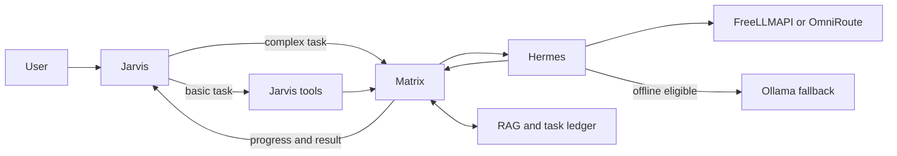

# API-First Friday Architecture Revision

## Architecture document
Rewrite [Friday_Trinity_Architecture_Plan_v2.md](/Users/mkhan24/pgvector/Friday_Trinity_Architecture_Plan_v2.md) around these boundaries:

- **Jarvis** is the face and basic-task executor: voice, hotkey, deterministic Mac actions, and user-facing progress.
- **Hermes** is the only complex-task executor: browser, email, research, coding, and multi-step work.
- **Matrix** is orchestration middleware between them: it assigns a task ID, checks policy, retrieves useful prior jobs, prepares a compact context packet, chooses an API profile/fallback, observes events, verifies completion evidence, records metrics, and requests recovery. It does not click, send, move, browse, or become a second agent brain.
- Replace the current architecture diagram and two-lane flow, remove Big-O terminology and 48/24 GB assumptions, and make the target explicitly a 16 GB machine.

## API-first and 16 GB model strategy
Document a configurable provider chain without embedding real keys:

- FreeLLMAPI as the default inexpensive OpenAI-compatible route; OmniRoute as the second gateway; optional direct API-key providers as later profiles. Let each gateway handle provider/key-level failover so Matrix does not duplicate it.
- Matrix selects only a task profile such as `fast`, `coding`, `reasoning`, or `vision`, enforces budgets, and records the actual model/provider returned.
- Use one local generation model at a time and unload idle models. Recommend `qwen3:4b-instruct` as the constrained emergency Hermes fallback because its Ollama artifact is about 2.5 GB, supports tools, and advertises sufficient context for Hermes's 64K requirement; mark its reliability as eval-gated.
- Recommend `qwen2.5-coder:7b` (about 4.7 GB, 32K) for bounded offline coding help, not as the full Hermes agent fallback because Hermes documents a 64K minimum.
- Use `bge-m3` (about 1.2 GB) on demand for embeddings, with SQLite FTS5 first and vector retrieval only when useful. Add RAM-pressure rules, short context packets, model unload policy, and measurements instead of claiming guaranteed memory usage.

## Matrix behavior and records
Replace the current router/Doctor/memory design with a supervisor workflow:

- Intake: classify basic versus complex, assign task ID, apply the external safety policy, estimate budget, and retrieve only the top relevant prior procedures/outcomes.
- Dispatch: pass Hermes a compact task packet containing the request, constraints, selected memories, prior verified steps, budget, and completion criteria.
- Observe: consume Hermes run events and Jarvis tool events; send Jarvis milestone updates immediately and heartbeat updates only for long quiet periods.
- Verify: require evidence from the executor before recording success; Matrix asks for re-check or reports uncertainty rather than performing the action itself.
- Persist a task ledger with steps, checkpoints, artifacts, errors, bugs, provider/model, prompt/completion tokens, estimated cost, latency, retries, and final verification.
- Specify on-demand and scheduled `.xlsx` export with sheets for Jobs, Steps, Costs, Bugs, Providers, and Summary; CSV remains the low-dependency fallback.

## RAG, interruption, and recovery
Define RAG as token-saving retrieval, not another autonomous brain:

- Store compact job summaries, verified procedures, errors/fixes, preferences, and artifact references; do not inject full transcripts by default.
- Before Hermes starts, retrieve similar successful jobs and known failures, deduplicate them, and enforce a context/token ceiling.
- On network loss, record the last verified step and artifacts, mark cloud-dependent work paused, and notify Jarvis.
- Continue deterministic offline work directly in Jarvis; allow Hermes to use Ollama only for tasks explicitly marked `offline_capable` and safe to replay.
- On reconnection, Matrix asks Hermes to inspect real state, reuse the task/idempotency key, and continue from the next unverified step. Do not claim an API model can resume hidden model state exactly.

## Separate safety policy
Create [Friday_Safety_Guardrails.md](/Users/mkhan24/pgvector/Friday_Safety_Guardrails.md) and replace the guardrails section in the main plan with a link and short integration contract.

- Organize editable rules by allow, notify, approve, deny, data handling, prompt injection, offline replay, and emergency stop.
- Give every rule a stable ID and explain precedence (`deny` overrides `approve`, which overrides `allow`).
- State that this Markdown is the design source; implementation must mirror it in a machine-readable `config/guardrails.yaml`, validate it at startup, and log the policy version used for every job. Editing prose alone must not silently change runtime enforcement.
- Reflect the selected policy: configured cloud APIs may receive task data, while secrets remain in environment variables/Keychain and are never placed in the documents or logs.

## Phases, tests, and consistency pass
Revise phases and acceptance tests around API-first operation, 16 GB stability, and the requested examples:

- Basic Jarvis actions remain direct and observable.
- “Send a mail to a colleague” passes through Matrix policy/RAG to Hermes, requests approval where configured, streams progress, verifies the sent item, and appears in the report.
- Gateway failover, token budget, prior-job retrieval, network interruption/resume, offline file work, local-model fallback, duplicate prevention, and Excel export each get explicit tests.
- Add a final consistency pass over startup commands, repo layout, risks, sources, terminology, and statements inherited from v2 so no local-first/48 GB contradictions remain.